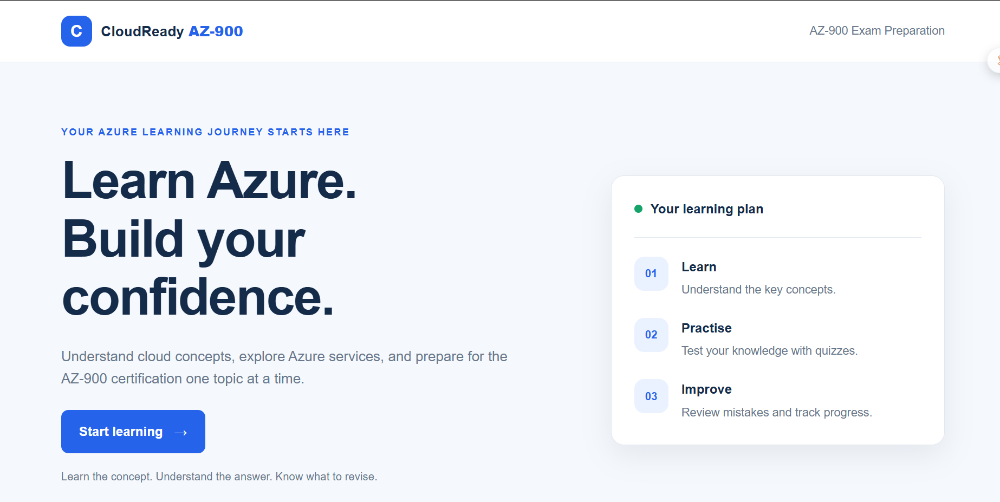
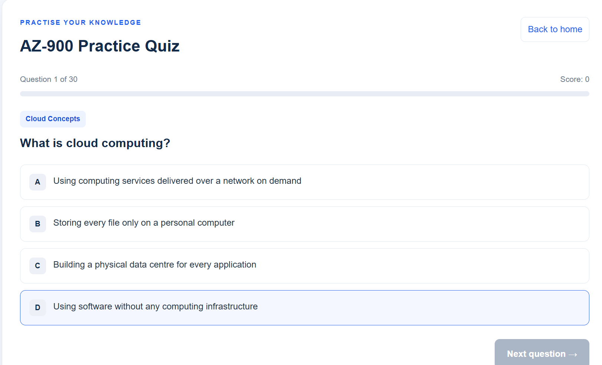
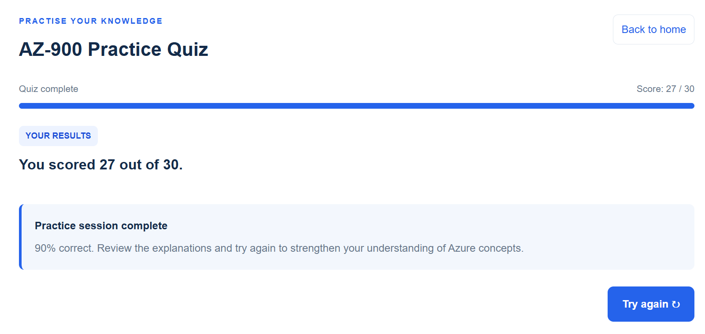

# CloudReady AZ-900

CloudReady AZ-900 is a browser-based practice quiz application designed to help learners prepare for the Microsoft Azure Fundamentals (AZ-900) certification exam.

## Live Demo

[Launch CloudReady AZ-900](https://femi-awonusi.github.io/cloudready-az900/)

## Screenshots

### Quiz Home



### Active Question



### Quiz Results



## Features

- Interactive AZ-900 practice quizzes.
- Questions organised by exam domain.
- Answer selection and feedback.
- Score tracking and performance summaries.
- Domain-based performance tracking.
- Review of quiz results.
- Responsive interface for different screen sizes.

## Technologies Used

- HTML5
- CSS3
- JavaScript
- Git and GitHub Pages

## Getting Started

### Run Locally

1. Clone or download this repository.
2. Open the project folder.
3. Open `index.html` in a web browser.

For a more consistent local development experience, use the Live Server extension in Visual Studio Code.

## Project Structure

```text
cloudready-az900/
├── data/
├── screenshots/
│   ├── quiz-home.png
│   ├── active-question.png
│   └── quiz-results.png
├── index.html
├── style.css
├── app.js
└── README.md
```

The `data/` directory contains the quiz question data used by the application. The `screenshots/` directory contains images of the application interface.

## Purpose

This project demonstrates practical frontend development skills, including JavaScript-based application logic, interactive user interfaces, data organisation, score calculation and deployment through GitHub Pages.

## Hackathon Documentation

Prompt-Engineering Evidence (docs/prompt-engineering-evidence.md) — Documents the AI-assisted development approach, prompting examples, testing, and verification.

Hackathon Pitch Notes(docs/hackathon-pitch-notes.md) — Includes the pitch slide content and speaker notes.

## Disclaimer

CloudReady AZ-900 is an independent learning project and is not affiliated with, endorsed by, or sponsored by Microsoft. It is intended as a supplementary study resource and does not guarantee certification success.
